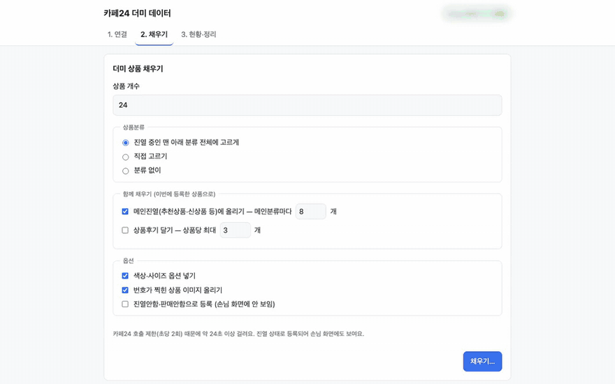
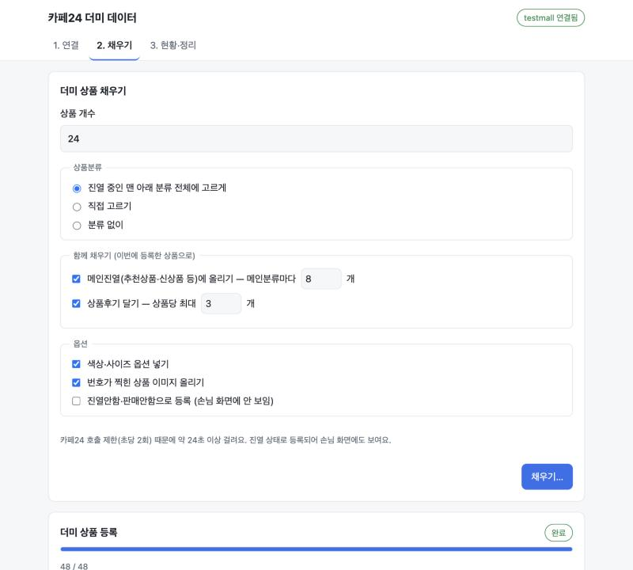
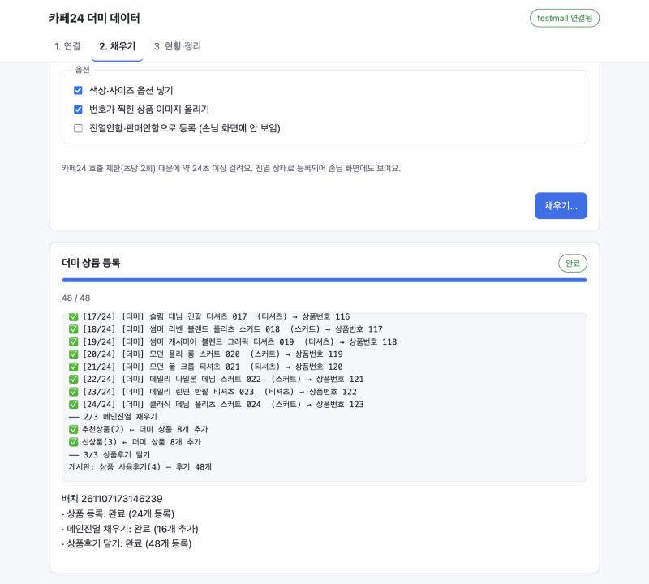
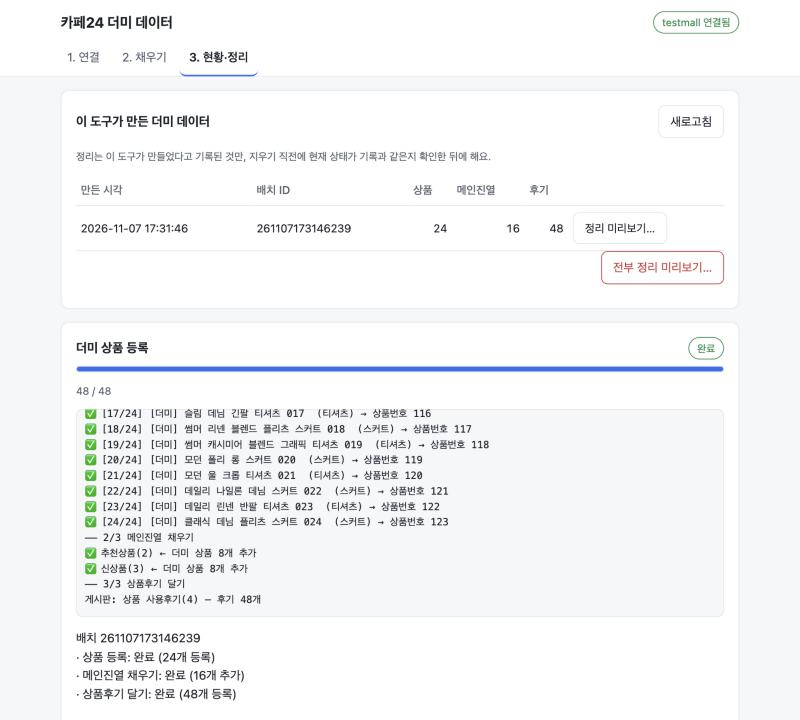

<div align="center">

# 🛍️ cafe24-dummy-products

**카페24 스킨 테스트용 더미 데이터, 한 번에 채우고 한 번에 치우기**

상품 · 메인진열 · 상품후기를 그럴듯하게 채워 넣고, 다 쓰면 **이 도구가 만든 것만** 골라서 지워요.

[](https://nodejs.org)
[](package.json)
[](LICENSE)
[](https://developers.cafe24.com)



<sub>실제 테스트 쇼핑몰에 등록하는 모습이에요 (1.6배속, 쇼핑몰 정보는 가렸어요)</sub>

</div>

> [!NOTE]
> 카페24와 무관한 개인 오픈소스 프로젝트예요. 손님이 들어오는 운영 쇼핑몰보다는 **테스트용 쇼핑몰**에서 쓰는 것을 권해요.

<br />

## ✨ 이런 걸 해요

| | |
| --- | --- |
| 🏷️ **그럴듯한 상품** | 한국어 상품명·가격·할인 전 가격·상세설명을 자동으로 만들어요. 분류 이름에 맞춰 상품명(Jackets → 자켓, Skirts → 스커트 …)과 옵션(의류 S~XL, 신발 230~270, 잡화는 색상만)을 골라요 |
| 🏪 **업종에 맞게** | 패션·뷰티·식품·리빙·디지털 중에서 고르면 상품명, 가격대, 옵션(용량·중량·호수 …), 후기 문구, 이미지 색과 글자가 그 업종에 맞게 바뀌어요 |
| 🖼️ **상품 이미지** | 업종별 색에 번호가 찍힌 이미지를 만들어 올려요. 목록·상세·축소 이미지는 카페24가 자동으로 맞춰요 |
| 🗂️ **여러 분류에 고르게** | 진열 중인 맨 아래 분류 전체에 나눠 넣거나, 원하는 분류만 골라요. 하위 분류에 넣으면 상위 분류 목록에도 보여요 |
| ⭐ **메인진열 · 상품후기** | 추천상품·신상품 같은 메인분류에 더미 상품을 올리고, 별점·작성일이 섞인 후기(포토후기 포함)를 달아요 |
| 🧹 **만든 것만 정리** | 만든 항목을 쇼핑몰별 소유 기록에 남기고, 지우기 직전에 현재 상태를 다시 확인해 **기록과 같은 것만** 지워요 |
| 🖥️ **화면으로 간편하게** | 터미널 명령 하나로 브라우저 화면이 열려요. 연결 → 채우기 → 현황·정리 세 단계면 끝 |
| 🤖 **AI 앱에서 말로 (MCP)** | Claude 같은 MCP 앱에 연결하면 "뷰티 상품 20개 채워 줘"처럼 말로 쓸 수 있어요. 지울 때는 반드시 사람이 브라우저에서 직접 승인해요 |
| 📦 **설치할 것 없음** | 외부 패키지 0개. Node.js 18.3 이상만 있으면 `npx`로 바로 실행돼요 |

<br />

## 🚀 빠른 시작

### 0. 준비물

- [Node.js](https://nodejs.org) 18.3 이상 (`node -v`로 확인)
- 테스트할 카페24 쇼핑몰의 관리자 계정
- 카페24 개발자센터 앱 (아래 [1단계](#app-setup)에서 만들어요)

<a id="app-setup"></a>

### 1. 카페24 개발자센터에서 앱 만들기 (처음 한 번)

1. [카페24 개발자센터](https://developers.cafe24.com)에 로그인해 **앱을 만들어요.**
2. 앱의 개발 정보에서 다음을 설정해요.

   | 항목 | 넣을 값 |
   | --- | --- |
   | **Redirect URI** | 쇼핑몰 자신의 주소 `https://<쇼핑몰ID>.cafe24.com` (권장). 그 주소에 별도 페이지가 없어도 돼요 |
   | **권한(Scope)** | 아래 다섯 가지를 **모두** 켜요 |

   | 권한 | 쓰는 곳 |
   | --- | --- |
   | `mall.read_product` · `mall.write_product` | 상품 조회·등록·삭제 |
   | `mall.read_category` | 상품분류 목록 |
   | `mall.read_community` · `mall.write_community` | 상품후기(게시판) 조회·등록·삭제 |

   > [!IMPORTANT]
   > 로그인할 때 다섯 권한을 한꺼번에 요청해요. 앱에 하나라도 빠져 있으면 승인 단계에서 오류가 나거나 일부 기능을 쓸 수 없어요. 권한을 바꾼 뒤에는 **다시 로그인**하세요.

3. **Client ID**와 **Client Secret**을 확인해 둬요. (Secret은 다른 사람과 공유하지 마세요)
4. 테스트할 쇼핑몰에 앱을 설치(테스트 실행)할 수 있는 상태인지 확인해요.

### 2. 화면 열기

```bash
npx github:kimyoungwopo/cafe24-dummy-products ui
```

처음 실행하면 npm이 `Ok to proceed? (y)`라고 물어요. `y`를 누르면 내려받아 바로 실행되고, 브라우저에 화면이 열려요.

<details>
<summary>매번 긴 명령이 번거롭다면 — 전역 설치</summary>

```bash
npm install -g github:kimyoungwopo/cafe24-dummy-products
cafe24-dummy ui
```

이 문서의 예시는 `cafe24-dummy …`로 적었어요. `npx`로 쓴다면 `cafe24-dummy` 자리에 `npx github:kimyoungwopo/cafe24-dummy-products`를 넣으면 돼요. 소스를 내려받아 쓴다면 `node src/cli.js …`예요.

</details>

### 3. 화면에서 세 단계로

| 단계 | 하는 일 |
| --- | --- |
| **1. 연결** | 쇼핑몰 주소, Client ID/Secret, Redirect URI를 저장 → **카페24 로그인 준비** → **승인 화면 열기**(새 창)에서 승인 → 이동한 페이지의 **주소창 URL 전체**를 붙여넣기 |
| **2. 채우기** | **업종**을 고르면 상품 하나를 예시로 보여 줘요. 상품 개수·분류·옵션·이미지를 고르고, 메인진열(메인분류마다 N개)과 상품후기(상품당 최대 N개)를 함께 채워요. 상품 → 메인진열 → 후기 순서로 진행 상황이 실시간으로 보여요 |
| **3. 현황·정리** | 이 도구가 만든 배치 목록이 보여요. **정리 미리보기**로 지울 대상과 건너뛸 항목을 확인하고, "되돌릴 수 없다"에 체크해야 정리가 시작돼요 |

<table>
  <tr>
    <td></td>
    <td></td>
    <td></td>
  </tr>
  <tr>
    <td align="center"><sub>채우기 옵션</sub></td>
    <td align="center"><sub>단계별 진행과 결과</sub></td>
    <td align="center"><sub>배치별 현황과 정리</sub></td>
  </tr>
</table>

<sub>위 세 장은 카페24를 흉내 낸 테스트용 목 서버에 연결한 화면이에요.</sub>

> [!TIP]
> 중간 단계가 실패해도 앞 단계 결과는 그대로 남고, 어느 단계가 "완료 / 일부 실패 / 멈춤 / 건너뜀"인지 숫자와 함께 알려 줘요. 멈춘 배치도 "현황·정리"에서 정리할 수 있어요.

<details>
<summary>🔒 화면은 얼마나 안전한가요?</summary>

- 이 컴퓨터에서만(127.0.0.1) 열리고, 실행할 때마다 바뀌는 비밀 토큰이 있어야 쓸 수 있어요. 다른 웹사이트가 몰래 요청을 보낼 수 없어요.
- 토큰이 든 주소는 화면이나 로그에 출력하지 않아요. 브라우저가 자동으로 안 열리면 `cafe24-dummy ui --copy-url`로 실행해 클립보드에 복사된 주소를 붙여넣으세요. (다른 사람과 공유하지 마세요)
- 새로고침하면 토큰이 사라지므로, 그때는 터미널에서 다시 실행하세요.

</details>

<br />

## ⌨️ 터미널로 쓰기

화면 대신 명령으로도 똑같이 할 수 있어요.

```bash
cafe24-dummy setup        # 연결 설정 (쇼핑몰, Client ID/Secret, Redirect URI)
cafe24-dummy login        # 카페24 로그인
cafe24-dummy status       # 설정 위치·로그인 상태 확인
```

<details>
<summary><b>setup · login 자세히</b></summary>

**setup** — 질문에 차례로 답하면 설정 파일이 만들어져요.

- **쇼핑몰 주소 또는 ID**: `myshop`, `https://myshop.cafe24.com/admin` 모두 돼요. 입력한 쇼핑몰이 실제로 있는지 바로 확인해서, 개발자센터 계정 ID를 넣는 실수를 알려 줘요.
- **Client Secret**: 입력해도 화면에 보이지 않고, Enter만 누르면 저장된 값을 그대로 둬요.
- **Redirect URI**: 기본값은 `https://<쇼핑몰ID>.cafe24.com`. 개발자센터에 등록한 값과 글자 하나까지 같아야 해요.

**login** — 브라우저에서 쇼핑몰 관리자로 로그인하고 권한을 승인해요. Redirect URI로 이동하면(페이지가 안 열려도 괜찮아요) **주소창의 URL 전체**를 복사해 터미널에 붙여넣고 Enter를 누르세요.

- 붙여넣은 내용에는 인증 코드가 있어서 화면에 표시하지 않아요.
- 인증 코드는 1분, 로그인 시도 하나는 10분 동안 유효하고 한 번만 쓸 수 있어요. 새 로그인을 시작하면 이전 시도의 URL은 더 이상 통하지 않아요.
- Access Token(2시간)은 자동으로 갱신돼요. Refresh Token(2주)이 만료되면 `login`을 다시 하면 돼요.

</details>

### 상품

```bash
cafe24-dummy categories                          # 상품분류 번호 확인
cafe24-dummy create -n 20 -c 24                  # 24번 분류에 20개
cafe24-dummy create -n 60 --spread --options     # 진열 중인 모든 맨 아래 분류에 고르게, 옵션 포함
cafe24-dummy create -n 20 -c 29,30,34,35         # 몇 개 분류에 번갈아
cafe24-dummy create -n 24 --spread --dry-run     # 실제 등록 없이 미리 보기
cafe24-dummy create -n 20 --preset beauty --options   # 뷰티 업종으로 (용량·컬러 옵션)
cafe24-dummy list                                # 이 도구가 등록한 더미 상품
```

<details>
<summary><b>create 옵션 전체</b></summary>

| 옵션 | 설명 |
| --- | --- |
| `-n, --count <수>` | 등록 개수 (기본 10, 최대 500) |
| `-p, --preset <업종>` | 업종 프리셋: `fashion`(기본) · `beauty` · `food` · `living` · `digital` |
| `-c, --category <번호>` | 진열할 상품분류 번호. 쉼표로 여러 개면 번갈아 배정 (`-c 29,30,32`) |
| `--spread` | 진열 중인 맨 아래 분류 전체에 고르게 나눠 등록 |
| `--options` | 업종에 맞는 옵션 추가 (패션: 색상·사이즈, 뷰티: 용량·컬러, 식품: 맛·중량 …) |
| `--hidden` | 진열안함·판매안함으로 등록 (손님 화면에 안 보임) |
| `--no-image` | 이미지 업로드 생략 (더 빠름) |
| `--prefix <문자열>` | 상품명 앞 문구 (기본 `[더미] `) |
| `--dry-run` | 등록하지 않고 보낼 내용만 출력 (분류 이름 확인을 위해 조회는 할 수 있음) |

등록이 끝나면 **배치 ID**가 나와요. 이 배치만 지울 때 써요.

</details>

### 업종 프리셋

```bash
cafe24-dummy presets        # 고를 수 있는 업종 목록
```

| 업종 | 상품 예시 | 옵션 예시 | 이미지 |
| --- | --- | --- | --- |
| `fashion` 패션 (기본) | 데님 자켓, 반팔 티셔츠, 플리츠 스커트, 스니커즈 | 색상 · 사이즈 | `DUMMY #001` |
| `beauty` 뷰티 | 세럼, 수분 크림, 립 틴트, 쿠션 파운데이션, 샴푸 | 용량 · 컬러 | `BEAUTY #001` |
| `food` 식품 | 버터 쿠키, 사과, 콜드브루 커피, 볶음밥 | 맛 · 중량 · 용량 · 구성 | `FOOD #001` |
| `living` 리빙 | 머그컵, 이불 커버, 디퓨저, 수납 바구니 | 색상 · 사이즈 · 크기 | `LIVING #001` |
| `digital` 디지털 | 태블릿, 충전기, 무선 이어폰, 블루투스 스피커 | 색상 · 용량 | `DIGITAL #001` |

- 상품분류 이름(예: Lip, 과일, 주방, 이어폰)에 맞는 상품을 골라요. 맞는 게 없으면 그 업종 상품 전체에서 골라요.
- 화면에서 채우기를 하면 상품과 후기에 **같은 업종**이 쓰여요. 터미널의 `reviews`는 배치마다 업종을 기억하지 않으니 `--preset`으로 직접 지정하세요 (생략하면 패션 문구).
- 업종이 달라도 자체상품코드(`DUMMY-…`)와 후기 표시(`[더미]` 제목, 정해진 작성자)는 같아서, 정리 방법과 안전장치는 똑같아요.
- 아직 직접 만든 프리셋 파일이나 내 이미지 폴더는 쓸 수 없어요. 다음 단계에서 추가할 예정이에요.

### 메인진열

```bash
cafe24-dummy mains                         # 메인분류 목록과 상품 수
cafe24-dummy fill-mains -n 8               # 모든 메인분류에 8개씩 (분류마다 다른 상품)
cafe24-dummy fill-mains -n 12 --group 2,3  # 특정 메인분류만
cafe24-dummy clear-mains                   # 이 도구가 넣은 진열만 빼기 (상품은 그대로)
```

> 메인분류 상품 조회 API에는 캐시가 있어 `mains`의 숫자가 잠시 틀릴 수 있어요. 실제 반영은 쇼핑몰 메인 화면에서 확인하세요.

### 상품후기

```bash
cafe24-dummy boards                 # 게시판 목록
cafe24-dummy reviews -n 3           # 이름에 "후기"/"review"가 들어간 게시판에 상품당 1~3개
cafe24-dummy reviews --board 4      # 게시판 번호를 직접 지정
cafe24-dummy reviews --preset food  # 식품 업종 후기 문구로
cafe24-dummy clear-reviews          # 이 도구가 단 후기만 삭제
```

> 별점은 1~5점이 섞이고, 작성일은 최근 두 달 안에 흩어지며, 3개 중 1개는 상품 이미지를 붙인 포토후기예요.

### 정리

```bash
cafe24-dummy delete --run 261107153012345   # 특정 배치만
cafe24-dummy delete                         # 이 도구가 만든 것 전부 (후기 → 메인진열 → 상품 순서)
```

지우기 전에 후기·메인진열·상품 개수와 앞의 몇 개를 보여 주고 확인을 받아요(`--yes`로 생략). `--run`에 빈 값이나 잘못된 값을 주면 아무것도 지우지 않고 오류로 끝나요.

<br />

<a id="mcp"></a>

## 🤖 AI 앱에서 쓰기 (MCP)

[MCP](https://modelcontextprotocol.io)를 지원하는 AI 앱(Claude Desktop, Claude Code 등)에 연결하면 말로 채우고 정리할 수 있어요.

**1. 먼저 연결 설정과 로그인을 해 두세요.** 로그인과 Client Secret은 보안을 위해 MCP로 다루지 않아요.

```bash
npx github:kimyoungwopo/cafe24-dummy-products ui
```

**2. AI 앱에 서버를 추가해요.**

<details>
<summary>Claude Code</summary>

```bash
claude mcp add cafe24-dummy -- npx -y github:kimyoungwopo/cafe24-dummy-products mcp
```

</details>

<details>
<summary>Claude Desktop 및 다른 MCP 앱 (설정 파일)</summary>

```json
{
  "mcpServers": {
    "cafe24-dummy": {
      "command": "npx",
      "args": ["-y", "github:kimyoungwopo/cafe24-dummy-products", "mcp"]
    }
  }
}
```

`-y`가 꼭 있어야 해요. MCP는 입출력을 앱과 주고받는 데 쓰기 때문에, 설치 확인 질문(`Ok to proceed?`)에 답할 수 없어요. 설정 폴더를 바꿨다면 `"env": { "CAFE24_HOME": "/설정/폴더" }`를 함께 넣으세요.

</details>

**3. 이렇게 말해 보세요.**

- "연결 상태 확인해 줘"
- "뷰티 업종으로 상품 20개, 메인분류마다 4개씩, 후기는 상품당 2개까지 채워 줘"
- "식품 업종 상품 예시 하나 보여 줘"
- "방금 만든 배치 정리해 줘"

| 도구 | 하는 일 |
| --- | --- |
| `get_status` | 설정·로그인·권한·진행 중인 작업 확인 (토큰·Secret은 돌려주지 않음) |
| `list_presets` · `list_categories` | 업종 목록 · 상품분류 목록 |
| `preview_products` | 업종별 예시 상품 하나 (등록하지 않음) |
| `start_seed` · `get_job` | 채우기 시작(바로 작업 ID를 돌려줌) · 진행과 단계별 결과 확인 |
| `list_batches` | 이 도구가 만든 배치 목록 |
| `plan_cleanup` · `execute_cleanup` | 정리 계획(10분 유효) · 정리 실행 (사람 승인 필요) |

> [!IMPORTANT]
> **지우기는 AI 혼자 할 수 없어요.** AI가 정리를 실행하려고 하면 이 컴퓨터의 브라우저에 **정리 확인 화면**이 열려요. 쇼핑몰, 배치, 지울 개수, 건너뛸 항목을 확인하고 "되돌릴 수 없다"에 체크한 뒤 직접 승인해야만 지워져요. 거절하면 그 계획은 버려지고 아무것도 지우지 않아요. 확인 화면 주소는 AI 앱이나 로그에 나오지 않아요. 창을 닫았다면 3분 뒤 AI가 다시 실행을 요청할 때 새로 열려요.

- 채우기·정리는 화면(`ui`)·터미널 명령과 같은 잠금을 써서 한 번에 하나만 실행돼요.
- 작업 중에 AI 앱을 닫아도, 진행 중인 작업과 소유 기록을 끝까지 마친 뒤에 서버가 종료돼요. 강제로 종료되면(전원 차단 등) 마지막 상품이 "결과 불명"일 수 있으니 `list_batches`나 화면의 "현황·정리"로 확인하세요.
- 상품명·분류명처럼 쇼핑몰에서 온 글은 AI에게 데이터로만 전달하고, 그 안의 지시를 따르지 말라고 서버가 안내해요.
- 2025년 방식(`initialize`)과 2026년 방식(요청마다 버전 정보) MCP 앱을 모두 지원해요.

<br />

## 🛡️ 지우는 기준 — "내가 만든 것만"

```
등록 성공 ──▶ 소유 기록에 바로 남김 ──▶ 정리할 때: 기록에 있음 + 지우기 직전 다시 조회한 상태가 기록과 같음 ──▶ 삭제
```

| 이런 데이터는 | 처리 |
| --- | --- |
| 이 도구가 만들고, 그 뒤로 바뀌지 않은 상품·메인진열·후기 | ✅ 지워요 |
| 자체상품코드가 `DUMMY-…` 형식이지만 소유 기록에 없는 상품 | 👀 보여 주기만 해요 |
| 등록 뒤 자체상품코드나 후기 내용(본문 포함)이 바뀐 것 | 👀 보여 주기만 해요 |
| 같은 표시를 단 진짜 고객 후기 | 🚫 건드리지 않아요 |
| 원래 있던(이 도구가 넣지 않은) 메인진열 | 🚫 건드리지 않아요 |
| 응답을 못 받아 실제 등록 여부를 모르는 요청("결과 불명") | 👀 보여 주기만 해요 |
| 예전 버전(소유 기록 도입 전)으로 만든 데이터 | 🔐 [따로 확인한 뒤에만](#legacy) |

그 밖의 안전장치:

- 상품 등록(POST)은 서버·네트워크 오류 때 **다시 보내지 않아요**. 응답만 잃고 실제로는 등록됐을 수 있어 중복을 막기 위해서예요. 조회·삭제는 최대 3번 다시 시도해요.
- 카페24 호출 제한(초당 2회, 버킷 40)을 지키고, 요청은 한 번에 하나씩 보내요. 429 오류는 자동으로 기다렸다 다시 보내요.
- 토큰 갱신은 여러 요청·여러 프로세스가 동시에 해도 한 번만 해요. (카페24는 갱신할 때마다 refresh token을 바꿔요)
- 데이터를 바꾸는 작업(화면 작업, `create`·`delete`·`fill-mains`·`clear-mains`·`reviews`·`clear-reviews`·`purge-legacy`)은 같은 설정 폴더에서 **한 번에 하나만** 실행돼요.
- 토큰·인증 코드·Secret은 `https://<쇼핑몰ID>.cafe24api.com`으로만 보내고, 리다이렉트를 따라가지 않아요. API 주소는 설정으로 바꿀 수 없어요.

<br />

## 📁 설정과 기록은 어디에 저장되나요?

`cafe24-dummy status`로 지금 쓰는 위치를 확인할 수 있어요.

| 우선순위 | 설정 폴더 |
| --- | --- |
| 1 | `CAFE24_HOME` 환경변수로 지정한 폴더 |
| 2 | 도구 폴더에 `.env`가 있으면 도구 폴더 (예전 버전 호환, 자동으로 옮기지 않음) |
| 3 | `~/.config/cafe24-dummy` (기본) |

설정 폴더 안에는 이런 파일이 생겨요. `npx`가 내려받은 파일을 지워도 이 폴더는 그대로라서, 다음에 실행해도 로그인과 소유 기록이 이어져요.

| 파일 | 내용 |
| --- | --- |
| `.env` | 쇼핑몰 ID, Client ID/Secret, Redirect URI |
| `.cafe24-token.json` | 로그인 토큰 |
| `owned/<쇼핑몰>-shop<번호>.jsonl` | 소유 기록 (정리할 때 쓰는 근거라 **지우지 마세요**) |

- 같은 값이 환경변수와 설정 파일에 모두 있으면 **환경변수가 우선**해요.
- 설정·토큰 파일은 나만 읽을 수 있는 권한(600)으로 저장되고, 저장 중에 실패해도 기존 파일은 그대로 남아요.
- 직접 편집하고 싶다면 [`.env.example`](.env.example)을 참고하세요.

<br />

<a id="legacy"></a>

## 🕰️ 예전 버전으로 만든 데이터 정리하기

v0.1.0(소유 기록 도입 전)으로 만든 상품·후기는 **소유로 인정하지 않아서** `delete`·`clear-reviews`가 지우지 않아요. 예전 로그에는 멀티쇼핑몰 번호가 없고, 후기 로그에는 쇼핑몰 ID도 없어 "이 쇼핑몰에서 이 도구가 만들었다"는 근거가 완전하지 않기 때문이에요. 지우고 싶다면 아래 순서로 직접 확인해 주세요.

1. **예전 로그 폴더 찾기** — 예전 버전을 쓰던 폴더의 `logs/` 안에 있는 `run-*.json`(상품), `reviews-*.json`(후기) 파일이 근거예요. 지우거나 옮기지 말고 그대로 두세요.
2. **쇼핑몰 확인** — `cafe24-dummy status`로 지금 연결된 쇼핑몰 ID가 예전에 더미를 만든 그 쇼핑몰인지 확인하세요. 멀티쇼핑몰이라면 `CAFE24_SHOP_NO`(기본 1)도 맞는지 확인하세요.
3. **미리 보기** — 로그 폴더 위치는 **항상 `CAFE24_LOG_DIR`로 직접 알려 주세요.** (실행하는 폴더가 아니라 설정 폴더를 기준으로 찾기 때문이에요)
   ```bash
   CAFE24_LOG_DIR="/예전/폴더/logs" cafe24-dummy purge-legacy --dry-run
   ```
   `--dry-run`은 아무것도 지우지 않고 **개수만** 보여 줘요.
   - 읽은 상품 로그·후기 로그 수, 다른 쇼핑몰 것이거나 형식이 잘못돼 건너뛴 파일
   - 지울 후보 수: 같은 쇼핑몰 로그에 있고 **지금 자체상품코드가 로그와 같은** 상품, 그 상품에 달린 더미 후기
   - 이미 없거나 바뀐 항목 수 (이것들은 지우지 않아요)
4. **직접 대조하기** — 미리 보기는 개별 상품번호를 보여 주지 않아요. 지우기 전에 예전 로그 파일의 상품번호·자체상품코드(`DUMMY-…`)를 카페24 관리자의 상품 목록과 직접 맞춰 보세요.
5. **지우기** — `--dry-run` 없이 실행하면 같은 요약을 다시 보여 주고 **쇼핑몰 ID를 그대로 입력**해야만 지워요. 지우기 직전에 한 번 더 조회해서 그사이 바뀐 것은 건너뛰어요.
   ```bash
   CAFE24_LOG_DIR="/예전/폴더/logs" cafe24-dummy purge-legacy
   # 또는 입력 대신 옵션으로: --confirm-mall <쇼핑몰ID>
   ```

> [!WARNING]
> - `-y`/`--yes`로는 확인을 건너뛸 수 없어요.
> - 소유 기록에 남은 "예전 로그에서 가져온" 줄만으로는 지울 후보가 되지 않아요. 근거는 항상 예전 로그 파일과 지금 쇼핑몰 상태예요.
> - 예전 후기는 상품번호와 더미 표시(제목·작성자)로만 확인해요. 새 버전처럼 본문까지 비교하지 않아요.
> - 예전 버전은 메인진열을 기록하지 않아서 정리 대상이 아니에요. 상품을 지우면 진열도 의미가 없어지니, 남아 있으면 카페24 관리자에서 빼 주세요.
> - 로그가 없거나 바뀐 항목은 자동으로 맞추지 않아요. 카페24 관리자에서 직접 확인해 주세요.

<br />

## 🧰 문제 해결

| 이런 메시지가 보이면 | 이렇게 해 보세요 |
| --- | --- |
| 쇼핑몰 주소를 찾을 수 없다 | 쇼핑몰 관리자 주소 `https://<쇼핑몰ID>.cafe24.com/admin`의 ID를 넣었는지 확인하세요. 개발자센터 계정 ID와 다를 수 있어요 |
| 승인 화면에서 redirect_uri 오류 | 개발자센터 앱에 등록한 Redirect URI와 `setup`에 넣은 값이 글자 하나까지 같은지 확인하세요 (`https`, 끝의 `/` 포함) |
| 승인 화면에서 권한(scope) 오류 | 앱 권한 다섯 가지를 모두 켰는지 확인하고 다시 로그인하세요 |
| 붙여넣은 URL을 받지 않는다 | 가장 최근에 연 승인 화면에서 승인한 뒤, 이동한 페이지의 **주소창 URL 전체**를 붙여넣으세요. 10분이 지났으면 로그인을 다시 시작하세요 |
| 브라우저가 열리지 않는다 | `login`은 출력된 승인 주소를 직접 브라우저에 붙여넣고, `ui`는 `--copy-url`로 실행하세요 |
| 설정이 비어 있다 / 로그인 정보가 없다 | `cafe24-dummy setup` → `cafe24-dummy login` 순서로 다시 하세요. `status`로 설정 폴더 위치를 확인할 수 있어요 |
| 토큰 갱신 실패, 다시 로그인하라는 안내 | Refresh Token(2주)이 만료됐어요. `cafe24-dummy login`을 다시 하세요 |
| 상품후기를 고를 수 없다 / 게시판 권한 오류 | 게시판 읽기·쓰기 권한을 켜고 다시 로그인하세요 |
| 다른 쓰기 작업이 실행 중이다 | 같은 설정 폴더를 쓰는 다른 창(화면 또는 터미널)의 작업이 끝난 뒤 다시 하세요 |
| 화면에 "세션 정보가 없어요" | 새로고침하면 토큰이 사라져요. 터미널에서 `ui` 명령을 다시 실행하세요 |
| 예전 데이터가 `delete`로 안 지워진다 | 의도된 동작이에요. [예전 버전 데이터 정리하기](#legacy)를 보세요 |

<br />

## ⚠️ 알아 두세요

- 기본값은 **진열함·판매함**이에요. 스킨 화면에 상품이 보여야 하기 때문이에요. 운영 쇼핑몰이라면 `--hidden`을 쓰거나 테스트 쇼핑몰에서 쓰세요.
- 카페24에서 삭제한 데이터는 **복구할 수 없어요.**
- 호출 제한 때문에 상품 1개당 약 1초(이미지 포함)가 걸려요. 100개면 2분 정도예요.
- 상품 목록 API에는 캐시가 있어 방금 등록한 상품이 `list`에 바로 안 보일 수 있어요. 정리는 소유 기록의 상품번호로 직접 조회하니 그 배치를 빠짐없이 지울 수 있어요.
- 로그인이 풀리거나 토큰 갱신이 실패하면 작업이 바로 멈춰요.

<details>
<summary>남는 한계</summary>

- 확인과 삭제 사이에 다른 사람이 같은 데이터를 바꾸는 경우는, 카페24에 조건부 삭제가 없어 완전히 막을 수 없어요.
- 카페24가 등록 성공 응답을 준 직후, 기록을 쓰기 전에 프로그램이 강제로 종료되면(전원 차단 등) 그 항목은 기록되지 않아요. 기록 쓰기 자체가 실패하면 기록하지 못한 항목을 ID와 함께 모두 보여 주고 즉시 멈춰요.
- 메인진열 목록 API에는 캐시가 있어 "목록에 없음"을 "없음"의 증거로 쓰지 않아요. 같은 이유로, 사람이 직접 메인에 올린 **더미 상품**의 진열을 도구가 넣은 것으로 기록할 가능성이 남아 있어요. 이때도 영향을 받는 것은 더미 상품의 진열뿐이에요.
- 더미 상품을 지우면 그 상품이 올라가 있던 메인진열(사람이 직접 올린 것 포함)도 의미가 없어져요. 남아 있으면 카페24 관리자에서 빼 주세요.
- 같은 쇼핑몰을 다른 컴퓨터에서 동시에 다루는 경우까지는 막지 못해요.

</details>

<br />

## 🧑‍💻 개발

```bash
git clone https://github.com/kimyoungwopo/cafe24-dummy-products.git
cd cafe24-dummy-products
npm test        # 카페24를 흉내 내는 목 서버로 전체 흐름 검증 (실제 쇼핑몰에 접속하지 않음)
node src/cli.js ui
```

<details>
<summary>폴더 구조</summary>

```
src/
  cli.js       명령 진입점 (출력·확인 질문만 담당)
  server.js    로컬 화면 서버 (127.0.0.1, 세션 토큰, Host/Origin 검사)
  service.js   화면·MCP 공통 작업 (입력 검사, 작업 1개씩, 정리 계획)
  mcp.js       MCP 서버 (stdio, 2025·2026 방식 모두)
  confirm.js   MCP 정리 확인 화면 서버 (사람 승인)
  http-guard.js 로컬 화면 서버 보안 도우미
  core.js      실제 작업 (등록, 소유 확인, 정리, 메인진열, 후기, 예전 데이터) — 화면도 같이 씀
  manifest.js  소유 기록 (쇼핑몰별 JSONL, 추가 전용)
  lock.js      프로세스 사이 잠금 (쓰기 작업 1개씩, 토큰 갱신 1번)
  auth.js      OAuth 로그인, 토큰 저장·자동 갱신
  api.js       Admin API 클라이언트 (호출 제한, 재시도)
  dummy.js     더미 상품 데이터 생성 (업종 프리셋 사용)
  presets.js   업종 프리셋 불러오기·형식 검사
  presets/     업종 프리셋 데이터 (fashion, beauty, food, living, digital)
  review.js    더미 후기 생성 (문구는 프리셋, 표시·작성자는 고정)
  image.js     더미 PNG 이미지 생성 (의존성 없음)
  config.js    설정 위치, 입력 검사, 상수
ui/            화면 (index.html, app.js, app.css, confirm.html/js — 외부 자원 없음)
test/
  run-cli.js          테스트 전용 실행기 (목 서버 주소를 코드로 지정, 배포 패키지에 없음)
  mock-server.js      카페24 API 목 서버
  cli.test.js         명령·핵심 동작 테스트
  ui.test.js          화면 서버 보안·전체 흐름 테스트
  concurrency.test.js 동시 실행·잠금 테스트
  mcp.test.js         MCP 프로토콜·도구·정리 승인 테스트 (실제 자식 프로세스)
  presets.test.js     업종 프리셋 (패션 결과가 예전과 똑같은지 포함)
  fixtures/           패션 기준 결과 (프리셋 도입 전에 저장)
```

</details>

<br />

## 📄 라이선스

[MIT](LICENSE) © Youngwoo Kim
